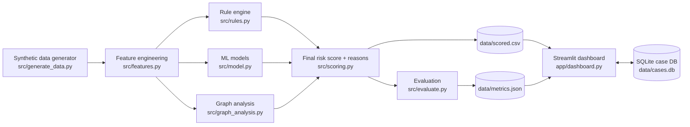

# 🛡️ UPI Sentinel

**Explainable fraud analytics for UPI and digital payments, built on synthetic data.**

Built for **Quick Heal Cyber Arena 2026 (LPU)**, Problem Statement **PS-17: UPI and Digital Payment Fraud Detection System**.

---

## 📌 Overview

UPI Sentinel is a fraud analytics prototype that scores synthetic UPI transactions for risk, explains *why* each one looks suspicious, and lets a fraud analyst review and close cases from a dashboard.

- **Hybrid detection:** rule engine + machine learning (Isolation Forest, Random Forest) + graph analysis of mule beneficiaries
- **Explainable:** every flagged transaction shows reason codes and evidence
- **Analyst workflow:** risk queue, transaction timelines, and case tracking (Open, Confirmed Fraud, False Positive, Escalated)
- **Honest evaluation:** precision, recall, F1, false positive rate and per-scenario detection rates, including legitimate "hard" cases
- **Privacy-first:** 100% synthetic data, masked IDs, no connection to any real payment network

## 🎯 Fraud Scenarios Covered

| Type | Scenario | What it simulates |
|------|----------|-------------------|
| Fraud | `VELOCITY_BURST` | Many transactions in a few minutes |
| Fraud | `HIGH_AMOUNT` | Amount far above the user's normal |
| Fraud | `NEW_BENEFICIARY_HIGH_VALUE` | Large transfer to a never-seen payee |
| Fraud | `ACCOUNT_TAKEOVER` | New device + new city + unusual behaviour |
| Fraud | `STRUCTURING` | Repeated amounts just under the limit |
| Fraud | `ODD_HOUR` | High-value activity at unusual hours |
| Fraud | `MULE_FANIN` | Many users paying one mule account |
| Legit | `LEGIT_FESTIVAL_SPIKE` | Genuine seasonal spending surge |
| Legit | `LEGIT_TRAVEL` | Genuine payments from a new city |
| Legit | `LEGIT_NEW_DEVICE` | Genuine switch to a new phone |
| Legit | `LEGIT_NEW_BEN` | Genuine first payment to a new payee |
| Normal | `NORMAL` | Regular day-to-day activity |

> The legitimate look-alike cases exist to test false positives, not just detection.

## 👥 Team

| Member | Role |
|--------|------|
| Person A | Data generator, feature engineering, evaluation metrics |
| Person B | Rules, ML model, graph analysis, final scoring |
| Person C | Streamlit dashboard, case tracking DB, documentation, demo video |


---

## 🏗️ Architecture



**Data flow in one line:** synthetic transactions → features → rules + ML + graph → one risk score (0-100) with reasons → dashboard → analyst decision saved to the case database.

## 📁 Folder Structure

```text
upi-sentinel/
├── app/
│   └── dashboard.py          # Streamlit dashboard (planned)
├── data/
│   ├── transactions.csv      # Synthetic UPI transactions
│   ├── features.csv          # Transactions + engineered features
│   ├── schema.md             # Column definitions
│   ├── scored.csv            # Risk scores + reasons (planned)
│   ├── metrics.json          # Evaluation results (planned)
│   └── cases.db              # Analyst case tracking, auto-created (planned)
├── docs/
│   ├── dataset_description.md
│   ├── privacy_safeguards.md # (planned)
│   └── technical_doc.md      # (planned)
├── src/
│   ├── generate_data.py      # Synthetic data generator
│   ├── features.py           # Feature engineering
│   ├── rules.py              # Rule engine with reason codes
│   ├── model.py              # Isolation Forest + Random Forest
│   ├── graph_analysis.py     # Mule beneficiary graph analysis
│   ├── scoring.py            # Final risk score (planned)
│   ├── evaluate.py           # Precision, recall, F1, FPR
│   └── db.py                 # SQLite case tracking (planned)
├── requirements.txt
├── Dockerfile                # (planned)
└── README.md
```

> Items marked *(planned)* are still being built and will be unmarked as they land.


---

## ⚙️ Setup

**Requirements:** Python 3.10+ (developed on 3.13), Git.

```powershell
# 1. Clone
git clone https://github.com/Pranoy13/upi-sentinel.git
cd upi-sentinel

# 2. Create and activate a virtual environment (Windows PowerShell)
python -m venv .venv
.venv\Scripts\Activate.ps1

# 3. Install dependencies
pip install -r requirements.txt
```

<details>
<summary>macOS / Linux</summary>

```bash
python3 -m venv .venv
source .venv/bin/activate
pip install -r requirements.txt
```

</details>

> If PowerShell blocks activation, run `Set-ExecutionPolicy -Scope CurrentUser RemoteSigned` once, then try again.

## ▶️ Run

The repository already ships with a generated synthetic dataset, so you can launch the dashboard straight away.

**Launch the dashboard (one command):**

```powershell
streamlit run app/dashboard.py
```

It opens at `http://localhost:8501`. If `data/scored.csv` is missing, the dashboard falls back to `data/features.csv` with a clearly labelled **demo scoring** banner.

**Regenerate the full pipeline (optional):**

```powershell
python -m src.generate_data     # synthetic transactions -> data/transactions.csv
python -m src.features          # engineered features   -> data/features.csv
python -m src.evaluate          # metrics -> data/metrics.json (needs src/scoring.py)
python -m src.evaluate --demo   # same, with a placeholder scorer (for testing)
python -m src.evaluate --threshold 60   # choose the risk threshold (default 60)
```

## 🧭 Dashboard Pages

| Page | What it shows |
|------|---------------|
| Overview | KPIs, risk threshold slider, risk score histogram, flagged count by scenario |
| High-Risk Queue | Flagged transactions with reasons and filters |
| Case View | Risk gauge, reasons, key features, user transaction timeline, related transactions, analyst actions |
| Cases | All analyst decisions with CSV export |
| Evaluation | Precision, recall, F1, false positive rate, confusion matrix, per-scenario detection |
| About / Privacy | Synthetic data and privacy safeguards |


---

## 📊 Evaluation

Detection is evaluated on a **time-based hold-out**: the model trains on the first 70% of transactions and is tested on the last 30%, so it never sees the future.

Reported metrics (written to `data/metrics.json` and shown on the dashboard's Evaluation page):

- Precision, recall, F1 and **false positive rate** at the chosen risk threshold
- Confusion matrix
- Per-scenario detection rate, including the four legitimate look-alike scenarios

*Results table: to be filled in once the final scoring pipeline is merged.*

## 🔒 Privacy and Safety

- All data is **synthetic**. No real transactions, customers or bank records are used.
- User, beneficiary and device IDs are **masked, generated identifiers**.
- The system has **no connection to any real payment network** (UPI, NPCI or banks).
- The dashboard is **read-only analytics**: it scores and reviews, it never moves money or blocks accounts.
- Analyst case notes are stored locally in SQLite (`data/cases.db`).

See `docs/privacy_safeguards.md` for details *(planned)*.

## 🖼️ Screenshots

*Screenshots will be added once the dashboard is complete.*

| Overview | High-Risk Queue |
|----------|-----------------|
| *(coming soon)* | *(coming soon)* |

| Case View with timeline | Evaluation |
|-------------------------|------------|
| *(coming soon)* | *(coming soon)* |

## 📄 Documentation

- [Dataset description](docs/dataset_description.md)
- [Data schema](data/schema.md)
- Technical documentation *(planned)*
- Privacy safeguards *(planned)*

## ⚠️ Disclaimer

UPI Sentinel is a hackathon prototype built on synthetic data. It is not a production fraud system and must not be used to make decisions about real customers or transactions.