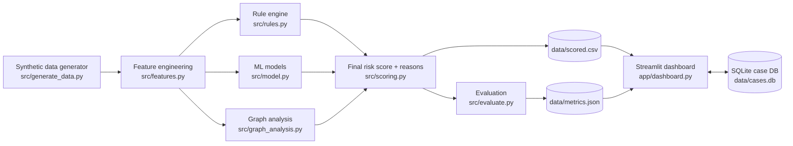

# 🛡️ UPI Sentinel

**Explainable fraud analytics for UPI and digital payments, built on synthetic data.**

Built for **Quick Heal Cyber Arena 2026 (LPU)**, Problem Statement **PS-17: UPI and Digital Payment Fraud Detection System**.

---

## 📌 Overview

UPI Sentinel is a fraud analytics prototype that scores synthetic UPI transactions for risk, explains *why* each one looks suspicious, and lets a fraud analyst review and close cases from a dashboard.

- **Hybrid detection:** rule engine + machine learning (Isolation Forest, Random Forest) + graph analysis of mule beneficiaries
- **Explainable:** every flagged transaction shows reason codes and evidence
- **Analyst workflow:** risk queue, transaction timelines, and case tracking (Open, Confirmed Fraud, False Positive, Escalated)
- **Honest evaluation:** precision, recall, F1, false positive rate and per-scenario detection rates, including legitimate "hard" cases
- **Privacy-first:** 100% synthetic data, masked IDs, no connection to any real payment network

## 🎯 Fraud Scenarios Covered

| Type | Scenario | What it simulates |
|------|----------|-------------------|
| Fraud | `VELOCITY_BURST` | Many transactions in a few minutes |
| Fraud | `HIGH_AMOUNT` | Amount far above the user's normal |
| Fraud | `NEW_BENEFICIARY_HIGH_VALUE` | Large transfer to a never-seen payee |
| Fraud | `ACCOUNT_TAKEOVER` | New device + new city + unusual behaviour |
| Fraud | `STRUCTURING` | Repeated amounts just under the limit |
| Fraud | `ODD_HOUR` | High-value activity at unusual hours |
| Fraud | `MULE_FANIN` | Many users paying one mule account |
| Legit | `LEGIT_FESTIVAL_SPIKE` | Genuine seasonal spending surge |
| Legit | `LEGIT_TRAVEL` | Genuine payments from a new city |
| Legit | `LEGIT_NEW_DEVICE` | Genuine switch to a new phone |
| Legit | `LEGIT_NEW_BEN` | Genuine first payment to a new payee |
| Normal | `NORMAL` | Regular day-to-day activity |

> The legitimate look-alike cases exist to test false positives, not just detection.

## 👥 Team

| Member | Role |
|--------|------|
| Person A | Data generator, feature engineering, evaluation metrics |
| Person B | Rules, ML model, graph analysis, final scoring |
| Person C | Streamlit dashboard, case tracking DB, documentation, demo video |


---

## 🏗️ Architecture



**Data flow in one line:** synthetic transactions → features → rules + ML + graph → one risk score (0-100) with reasons → dashboard → analyst decision saved to the case database.

## 📁 Folder Structure

```text
upi-sentinel/
├── app/
│   └── dashboard.py          # Streamlit dashboard (planned)
├── data/
│   ├── transactions.csv      # Synthetic UPI transactions
│   ├── features.csv          # Transactions + engineered features
│   ├── schema.md             # Column definitions
│   ├── scored.csv            # Risk scores + reasons (planned)
│   ├── metrics.json          # Evaluation results (planned)
│   └── cases.db              # Analyst case tracking, auto-created (planned)
├── docs/
│   ├── dataset_description.md
│   ├── privacy_safeguards.md # (planned)
│   └── technical_doc.md      # (planned)
├── src/
│   ├── generate_data.py      # Synthetic data generator
│   ├── features.py           # Feature engineering
│   ├── rules.py              # Rule engine with reason codes
│   ├── model.py              # Isolation Forest + Random Forest
│   ├── graph_analysis.py     # Mule beneficiary graph analysis
│   ├── scoring.py            # Final risk score (planned)
│   ├── evaluate.py           # Precision, recall, F1, FPR
│   └── db.py                 # SQLite case tracking (planned)
├── requirements.txt
├── Dockerfile                # (planned)
└── README.md
```

> Items marked *(planned)* are still being built and will be unmarked as they land.