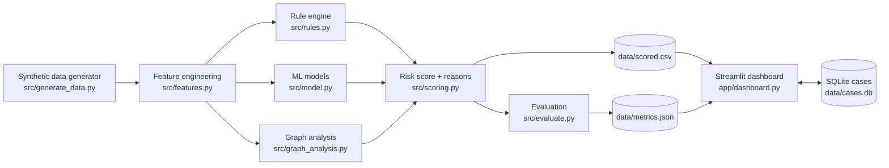
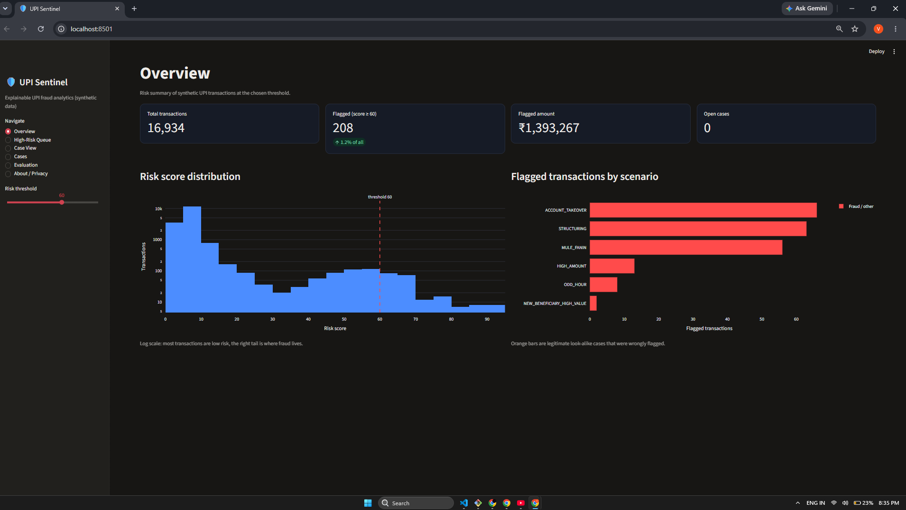
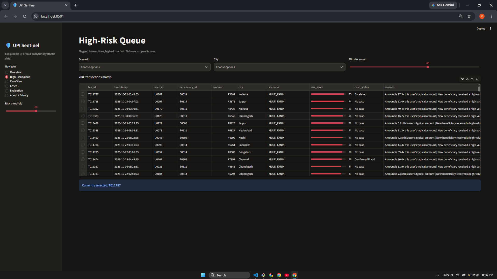
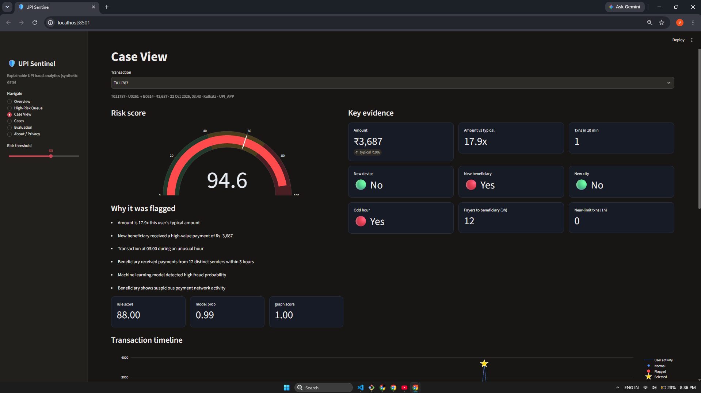
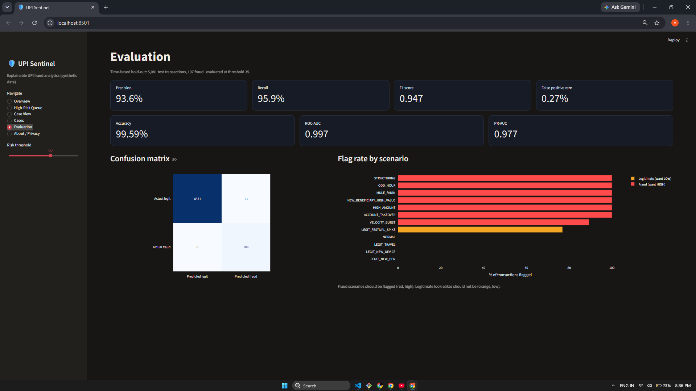

# 🛡️ UPI Sentinel

**Explainable fraud analytics for UPI and digital payments, built on synthetic data.**

Built for **Quick Heal Cyber Arena 2026 (LPU)** · Problem Statement **PS-17: UPI and Digital Payment Fraud Detection System** · Team **cyberBurst**

**🔗 Live demo:** https://upi-sentinel-cznf5mv4dh2or5ouhztrdy.streamlit.app/

---

## 📌 Overview

UPI Sentinel scores synthetic UPI transactions for risk, explains *why* each one looks suspicious, and lets a fraud analyst review and close cases from a dashboard.

- **Hybrid detection:** rule engine + machine learning (Isolation Forest, Random Forest) + graph analysis of mule beneficiaries
- **Explainable:** every flagged transaction shows reason codes and evidence
- **Analyst workflow:** risk queue, transaction timelines, and case tracking (Open, Confirmed Fraud, False Positive, Escalated)
- **Honest evaluation:** time-based hold-out with precision, recall, F1, false-positive rate and per-scenario detection, including legitimate look-alike cases
- **Privacy-first:** 100% synthetic data, masked IDs, no connection to any real payment network

## 📊 Results

Evaluated on a **time-based hold-out** (model trains on the first 70% of transactions, tested on the last 30%: 5,081 transactions, 197 fraud) at risk threshold 35.

| Metric | Value |
|---|---|
| Precision | 93.97% |
| Recall | 94.92% |
| F1 score | 94.44% |
| False-positive rate | 0.25% |
| ROC-AUC / PR-AUC | 0.997 / 0.979 |
| Confusion matrix | TN 4872 · FP 12 · FN 10 · TP 187 |

- Account takeover, high amount, mule fan-in, new-beneficiary high value, odd hour and structuring are detected at **100%**; velocity bursts at **86.7%**.
- Legitimate look-alikes (new payee, new device, travel) are **never flagged**. Genuine festival spikes are the main known weakness (10 of 13 flagged).
- The threshold slider in the dashboard lets an analyst trade precision against recall. See `data/threshold_sweep.csv`.

## 🎯 Scenarios Covered

| Type | Scenario | What it simulates |
|------|----------|-------------------|
| Fraud | `VELOCITY_BURST` | Many transactions within minutes |
| Fraud | `HIGH_AMOUNT` | Amount far above the user's normal |
| Fraud | `NEW_BENEFICIARY_HIGH_VALUE` | Large transfer to a never-seen payee |
| Fraud | `ACCOUNT_TAKEOVER` | New device + new city + unusual behaviour |
| Fraud | `STRUCTURING` | Repeated amounts just under the limit |
| Fraud | `ODD_HOUR` | High-value activity at unusual hours |
| Fraud | `MULE_FANIN` | Many users paying one mule account |
| Legit | `LEGIT_FESTIVAL_SPIKE` | Genuine seasonal spending surge |
| Legit | `LEGIT_TRAVEL` | Genuine payments from a new city |
| Legit | `LEGIT_NEW_DEVICE` | Genuine switch to a new phone |
| Legit | `LEGIT_NEW_BEN` | Genuine first payment to a new payee |
| Normal | `NORMAL` | Regular day-to-day activity |

## 🏗️ Architecture



Risk score = 0.40 × rule score + 45 × model probability + 15 × graph score, clipped to 0-100. Details: [docs/technical_doc.md](docs/technical_doc.md).

## 📁 Folder Structure

```text
upi-sentinel/
├── app/dashboard.py            # Streamlit dashboard
├── data/                       # transactions, features, scored data, metrics, schema
├── docs/                       # dataset description, technical doc, privacy, screenshots
├── src/
│   ├── generate_data.py        # synthetic data generator
│   ├── features.py             # feature engineering
│   ├── rules.py                # rule engine with reason codes
│   ├── model.py                # Isolation Forest + Random Forest
│   ├── graph_analysis.py       # mule beneficiary graph analysis
│   ├── scoring.py              # final risk score + reasons
│   ├── evaluate.py             # metrics on time-based hold-out
│   └── db.py                   # SQLite case tracking
├── .streamlit/config.toml      # dark theme
├── Dockerfile
├── requirements.txt
└── README.md
```

## ⚙️ Setup

**Requirements:** Python 3.10+ (developed on 3.13), Git.

```powershell
git clone https://github.com/Pranoy13/upi-sentinel.git
cd upi-sentinel
python -m venv .venv
.venv\Scripts\Activate.ps1
pip install -r requirements.txt
```

<details>
<summary>macOS / Linux</summary>

```bash
python3 -m venv .venv
source .venv/bin/activate
pip install -r requirements.txt
```

</details>

## ▶️ Run

The repository ships with the generated dataset, scores and metrics, so the dashboard runs straight away:

```powershell
streamlit run app/dashboard.py
```

Opens at `http://localhost:8501`.

**Docker:**

```powershell
docker build -t upi-sentinel .
docker run -p 8501:8501 upi-sentinel
```

**Regenerate the full pipeline (optional):**

```powershell
python -m src.generate_data           # -> data/transactions.csv
python -m src.features                # -> data/features.csv
python -m src.scoring                 # -> data/scored.csv (trains the model on first run)
python -m src.evaluate --threshold 35 # -> data/metrics.json
```

## 🧭 Dashboard Pages

| Page | What it shows |
|------|---------------|
| Overview | KPIs, risk threshold slider, score histogram, flagged count by scenario |
| High-Risk Queue | Flagged transactions with reasons and filters |
| Case View | Risk gauge, reasons, key features, user timeline, related transactions, analyst actions |
| Cases | All analyst decisions with CSV export |
| Evaluation | Precision, recall, F1, FPR, confusion matrix, per-scenario detection |
| About / Privacy | Synthetic data and privacy safeguards |

## 🖼️ Screenshots

| Overview | High-Risk Queue |
|----------|-----------------|
|  |  |

| Case View with timeline | Evaluation |
|-------------------------|------------|
|  |  |

## 🔒 Privacy and Safety

- All data is **synthetic**; no real transactions, customers or bank records.
- IDs are **masked, generated identifiers**.
- **No connection to any real payment network** (UPI, NPCI or banks).
- **Read-only analytics**: it scores and reviews, never moves money or blocks accounts.
- `is_fraud` and `scenario` are never used as model features.

See [docs/privacy_safeguards.md](docs/privacy_safeguards.md).

## 📄 Documentation

- [Technical documentation](docs/technical_doc.md)
- [Dataset description](docs/dataset_description.md)
- [Privacy safeguards](docs/privacy_safeguards.md)
- [Data schema](data/schema.md)

## 👥 Team cyberBurst

| Member | Role |
|--------|------|
| Pranoy Albin Mascarinus | Data generator, feature engineering, evaluation, deployment |
| Arjun Ratheesh (captain) | Rules, ML model, graph analysis, scoring |
| Vyshnav | Dashboard, case tracking, documentation, demo |

## ⚠️ Disclaimer

UPI Sentinel is a hackathon prototype built on synthetic data. It is not a production fraud system and must not be used to make decisions about real customers or transactions.
